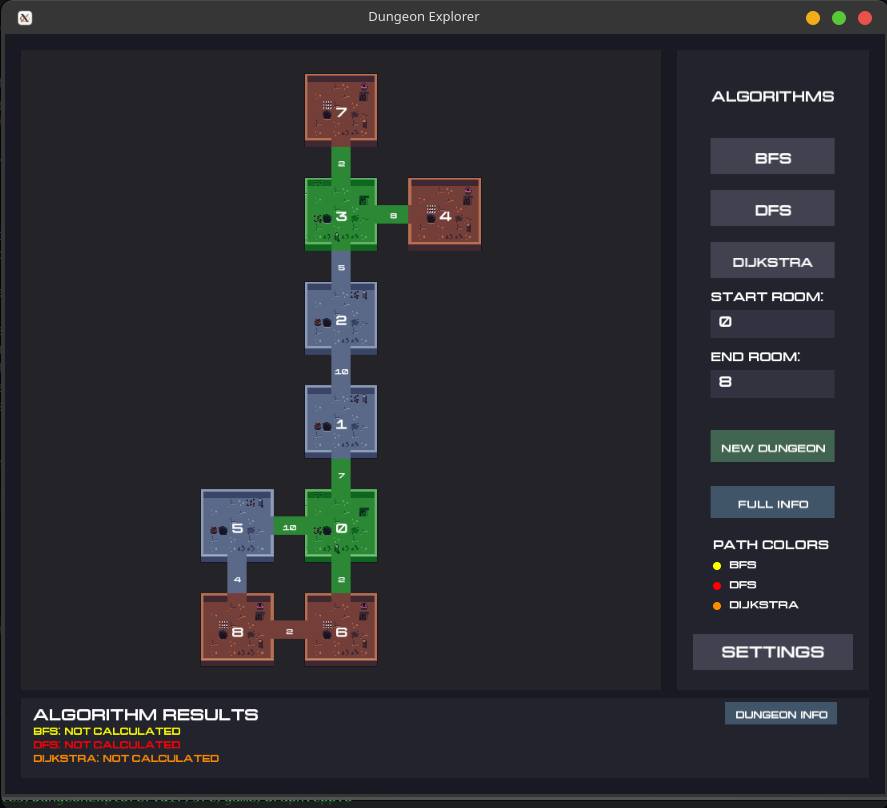
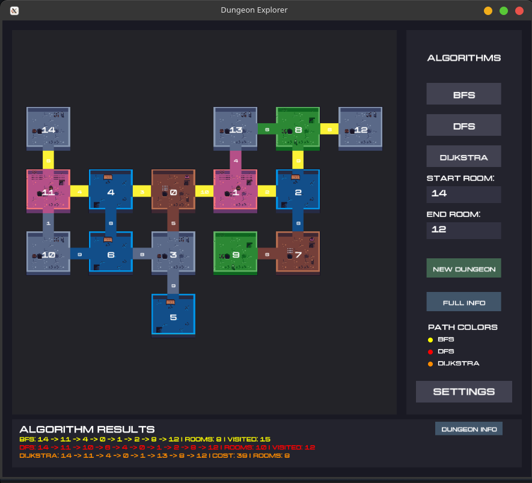
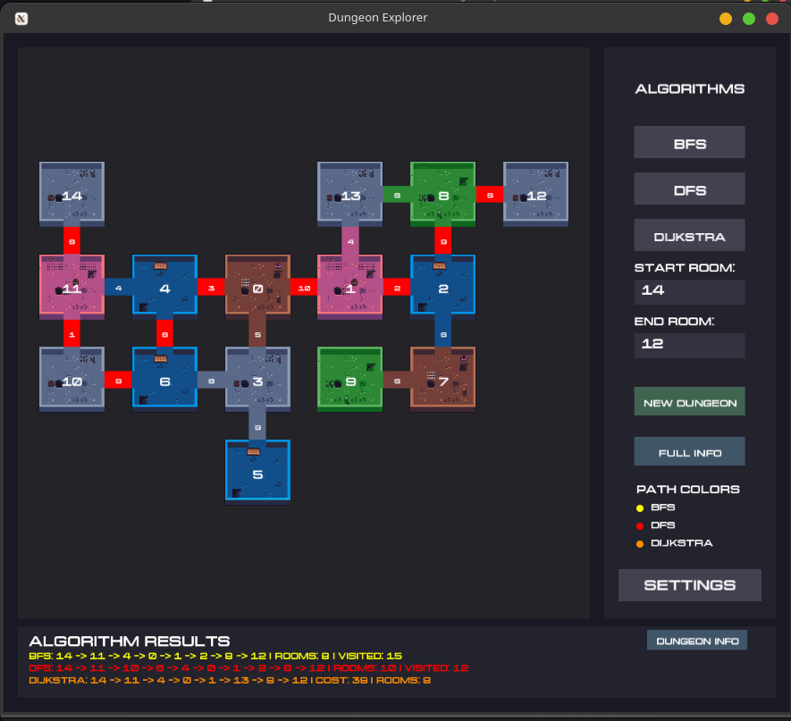

# Dungeon Explorer

<p align="center">
  
</p>

> **Разработка игровой системы генерации подземелий и поиска маршрутов на основе графов**

Приложение на C++17 для процедурной генерации подземелий, построения графов и визуализации поиска маршрутов. Проект объединяет случайную генерацию структуры подземелий с классическими алгоритмами обхода графов и поиска кратчайших путей, позволяя наглядно изучать работу графовых структур и алгоритмов.

---

## Содержание

- [Обзор проекта](#обзор-проекта)
- [Цели проекта](#цели-проекта)
- [Возможности](#возможности)
- [Режим Explorer Mode](#режим-explorer-mode)
- [Процедурная генерация подземелий](#процедурная-генерация-подземелий)
- [Модель графа](#модель-графа)
- [Алгоритмы поиска маршрутов](#алгоритмы-поиска-маршрутов)
- [Настройки генерации](#настройки-генерации)
- [Визуальная система](#визуальная-система)
- [Структура проекта](#структура-проекта)
- [Используемые технологии](#используемые-технологии)
- [Системные требования](#системные-требования)
- [Сборка и запуск](#сборка-и-запуск)
- [Использование приложения](#использование-приложения)
- [Планы развития](#планы-развития)
- [Планируемые игровые режимы](#планируемые-игровые-режимы)
- [Текущий статус проекта](#текущий-статус-проекта)

---

## Обзор проекта

Dungeon Explorer — графическое приложение, посвящённое процедурной генерации подземелий и поиску маршрутов на основе графов.

Каждое сгенерированное подземелье состоит из комнат, соединённых проходами. Расположение комнат представляет собой визуальную модель графа: комнаты выступают в роли вершин, а проходы между ними — в роли рёбер. Каждое соединение может иметь вес, который используется алгоритмами поиска кратчайшего пути.

Приложение позволяет генерировать различные планировки подземелий, настраивать параметры генерации, изучать полученную структуру графа и сравнивать маршруты, найденные несколькими известными алгоритмами.

Проект задуман как интерактивное приложение и практическая демонстрация теории графов, процедурной генерации и алгоритмов поиска маршрутов.

## Цели проекта

Основные цели проекта:

- Разработать систему процедурной генерации подземелий
- Представить сгенерированные подземелья в виде связных графов
- Реализовать и продемонстрировать алгоритмы обхода графов и поиска кратчайших путей
- Визуализировать соединения графа, веса рёбер и найденные маршруты
- Предусмотреть возможность настройки параметров генерации
- Создать основу для дальнейшего добавления игровых механик

## Возможности

### Реализовано

- Процедурная генерация комнат подземелья
- Случайное количество комнат в заданном диапазоне
- Размещение комнат на условной сетке
- Ортогональные соединения между соседними комнатами
- Генерация связного графа подземелья
- Предотвращение повторных соединений
- Настраиваемая плотность графа
- Случайные веса рёбер в заданном диапазоне
- Алгоритмы поиска BFS, DFS и Dijkstra
- Визуальное выделение найденных маршрутов
- Отдельные визуальные стили для результатов разных алгоритмов
- Несколько наборов текстур комнат
- Визуализация коридоров и их весов
- Автоматическое масштабирование подземелья под доступную область просмотра
- Окно настроек генерации с кнопками Apply, Cancel и Reset

---

## Режим Explorer Mode

Explorer Mode — основной реализованный режим приложения. Он предназначен для генерации подземелий и изучения лежащей в их основе структуры графа.

Пользователь может создать подземелье, настроить параметры генерации и запустить алгоритмы поиска маршрутов на полученном графе. Приложение отображает расположение комнат, проходы между ними, веса соединений и маршрут, найденный выбранным алгоритмом.

Explorer Mode включает следующие возможности:

1. **Генерация подземелья** — создание новой случайной планировки комнат.
2. **Построение графа** — соединение ортогонально соседних комнат.
3. **Поиск маршрутов** — запуск BFS, DFS или Dijkstra на сгенерированном графе.
4. **Визуализация маршрута** — выделение пути, найденного выбранным алгоритмом.
5. **Настройка генерации** — изменение количества комнат, диапазона весов рёбер и плотности графа.

На текущем этапе Explorer Mode считается функционально завершённым. Дальнейшее развитие проекта будет сосредоточено на отдельном игровом режиме, а не на добавлении новых функций в этот режим.

## Процедурная генерация подземелий

Генерация подземелья основана на условной двумерной сетке.

### Размещение комнат

- Первая комната размещается в начальной координате сетки `(0, 0)`.
- Остальные комнаты добавляются по одной.
- Каждая новая комната размещается в свободной ортогональной клетке рядом с уже существующей комнатой.
- Генерация продолжается до достижения случайно выбранного количества комнат.
- Количество комнат определяется настройками генерации.

Такой подход позволяет формировать связную структуру непосредственно в процессе размещения комнат и предотвращает размещение нескольких комнат в одной клетке.

### Соединение комнат

После размещения комнат система строит графовые соединения между ними.

Соединяться могут только ортогонально соседние комнаты:

- Вверх
- Вниз
- Влево
- Вправо

Диагональное расположение комнат не создаёт диагональных соединений графа.

Генерация соединений выполняется в два этапа:

1. **Обеспечение связности** — каждая комната, добавленная после начальной, соединяется с одной из ранее созданных ортогонально соседних комнат. Это позволяет сохранить связность графа.
2. **Добавление дополнительных соединений** — система проверяет пары ортогонально соседних комнат и может создавать дополнительные связи с учётом установленной плотности графа.

Повторные соединения не создаются.

Связность имеет приоритет над ограничением плотности: система должна гарантировать связность подземелья, даже если обязательное соединение приводит к превышению предпочтительного максимального количества связей у комнаты.

### Веса соединений

Каждое ребро графа получает случайный вес из установленного минимального и максимального диапазона.

Эти веса используются алгоритмом Dijkstra, а также отображаются непосредственно в подземелье.

---

## Модель графа

Сгенерированное подземелье представляется в виде неориентированного взвешенного графа.

| Элемент подземелья | Элемент графа |
|---|---|
| Комната | Вершина (узел) |
| Проход / коридор | Ребро |
| Вес коридора | Вес ребра |
| Планировка подземелья | Визуальное представление графа |

Граф является неориентированным, поскольку проход соединяет две комнаты в обоих направлениях.

Граф является взвешенным, поскольку каждое соединение имеет числовую стоимость. Это позволяет демонстрировать как алгоритмы обхода графа, так и поиск кратчайшего пути с учётом весов.

Процесс генерации направлен на создание связного графа, поэтому из начальной комнаты можно добраться до любой другой сгенерированной комнаты.

## Алгоритмы поиска маршрутов

В приложении реализованы три алгоритма работы с графами.

### Поиск в ширину (BFS)

Breadth-First Search — алгоритм, который исследует граф по уровням, сначала посещая ближайшие к начальной вершине вершины, а затем переходя к более удалённым.

- Использует очередь
- Находит маршрут с минимальным количеством рёбер в невзвешенном графе
- Не учитывает веса коридоров при выборе маршрута

**Визуализация:** найденный маршрут BFS выделяется жёлтым цветом.



### Поиск в глубину (DFS)

Depth-First Search — алгоритм, который старается пройти как можно дальше по одной ветви графа, прежде чем вернуться назад и исследовать другие направления.

- Использует стек или рекурсивный обход
- Исследует граф в глубину
- Находит допустимый маршрут, если он существует, но не гарантирует минимальное количество рёбер или минимальный суммарный вес

**Визуализация:** найденный маршрут DFS выделяется красным цветом.



### Алгоритм Дейкстры (Dijkstra)

Алгоритм Дейкстры находит путь с минимальным суммарным весом от начальной вершины до конечной при условии, что веса рёбер неотрицательны.

- Учитывает веса коридоров
- Хранит наилучшее известное расстояние до каждой вершины
- Обновляет маршруты, если находит путь с меньшей стоимостью

**Визуализация:** найденный маршрут Dijkstra выделяется оранжевым цветом.


### Сравнение алгоритмов

| Алгоритм | Учитывает веса рёбер | Принцип работы | Гарантия результата |
|---|---|---|---|
| BFS | Нет | Обход по уровням | Минимальное количество рёбер |
| DFS | Нет | Обход в глубину | Допустимый маршрут, не обязательно оптимальный |
| Dijkstra | Да | Выбор вершины с минимальной накопленной стоимостью | Минимальный суммарный вес при неотрицательных весах |

Результаты работы алгоритмов могут отличаться, поскольку каждый из них использует собственный принцип поиска. В частности, маршрут с наименьшим количеством соединений не обязательно имеет наименьший суммарный вес.

---

## Настройки генерации

Параметры генерации подземелья можно изменять в отдельном окне Settings.

### Количество комнат

Определяет минимальное и максимальное количество комнат, которые могут быть сгенерированы.

- Minimum Rooms — минимальное количество комнат
- Maximum Rooms — максимальное количество комнат

Итоговое количество комнат выбирается случайным образом в пределах заданного диапазона, включая его границы.

### Вес соединений

Определяет диапазон случайных весов, присваиваемых соединениям между комнатами.

- Minimum Path Weight — минимальный вес соединения
- Maximum Path Weight — максимальный вес соединения

Минимальное значение не должно превышать максимальное.

### Плотность графа

Определяет, сколько дополнительных соединений может быть создано между соседними комнатами.

| Настройка | Значение | Описание |
|---|---:|---|
| Low | 1 | Низкая предпочтительная плотность соединений |
| Medium | 2 | Средняя предпочтительная плотность соединений |
| High | 3 | Высокая предпочтительная плотность соединений |

Значение плотности используется для определения предпочтительного максимального количества соединений комнаты при добавлении дополнительных рёбер. Обязательные соединения, необходимые для сохранения связности графа, имеют приоритет.

### Применение настроек

Ниже показано окно настроек генерации подземелья.


Окно настроек предоставляет три действия:

- **Apply** — проверяет введённые значения и применяет настройки.
- **Cancel** — закрывает окно без применения текущих изменений.
- **Reset** — восстанавливает значения по умолчанию в полях настроек. Для применения восстановленных значений необходимо дополнительно нажать Apply.

---

## Визуальная система

Визуальная система представляет сгенерированный граф в виде подземелья.

### Внешний вид комнат

В проекте предусмотрено пять наборов текстур комнат:

- `room_1` — розовый
- `room_2` — зелёный
- `room_3` — синий
- `room_4` — серый
- `room_5` — коричневый

Каждый набор текстур содержит основное изображение комнаты и прозрачные накладки для проходов сверху, слева, снизу и справа.

### Коридоры

Соединения между комнатами отображаются с помощью текстур коридоров. Внешний вид обычного коридора выбирается в соответствии с набором текстур комнаты.

### Визуализация маршрутов

Для отображения результатов алгоритмов используются отдельные текстуры коридоров:

| Алгоритм | Цвет маршрута |
|---|---|
| BFS | Жёлтый |
| DFS | Красный |
| Dijkstra | Оранжевый |

Одновременно отображается только маршрут последнего запущенного алгоритма. Запуск другого алгоритма заменяет ранее выделенный маршрут.

### Отображение подземелья

Размер подземелья автоматически подстраивается под доступную область просмотра. Это позволяет просматривать сгенерированные планировки независимо от их размеров.

---

## Структура проекта

Проект разделён на компоненты пользовательского интерфейса и игровой логики.

```text
project-graph/
├── CMakeLists.txt
├── assets/
│   ├── fonts/
│   │   └── HS_LunaObscura.ttf
│   └── textures/
│       ├── room_1/
│       ├── room_2/
│       ├── room_3/
│       ├── room_4/
│       ├── room_5/
│       └── roads/
└── src/
    ├── main.cpp
    ├── ui/
    │   ├── Menu.h
    │   └── Menu.cpp
    └── game/
        ├── Game.hpp
        ├── Game.cpp
        ├── Graph.hpp
        └── Graph.cpp
```

### Основные компоненты

| Файл | Назначение |
|---|---|
| `main.cpp` | Точка входа в приложение |
| `ui/Menu.h` / `ui/Menu.cpp` | Интерфейс главного меню |
| `game/Game.hpp` / `game/Game.cpp` | Основной игровой цикл, отрисовка, обработка ввода и состояние приложения |
| `game/Graph.hpp` / `game/Graph.cpp` | Структура графа, генерация подземелья, соединения, веса и алгоритмы поиска |
| `CMakeLists.txt` | Конфигурация сборки проекта с помощью CMake |
| `assets/` | Шрифты и визуальные ресурсы |

Архитектура разделяет графическую часть приложения и логику работы с графами и генерацией подземелий.

---

## Используемые технологии

- **C++17** — основной язык программирования
- **SFML 3.0.2** — графика, управление окном и обработка ввода
- **CMake** — конфигурация проекта и система сборки
- **Git** — система контроля версий

## Системные требования

Для сборки проекта необходимы:

- Компилятор C++ с поддержкой стандарта C++17
- CMake
- Библиотеки разработки SFML 3.0.2
- Git (необязательно, для клонирования репозитория)

Точная процедура установки SFML зависит от операционной системы и используемого менеджера пакетов.

## Сборка и запуск

Следующие команды предназначены для Linux при условии, что все необходимые зависимости уже установлены.

### 1. Клонирование репозитория

```bash
git clone https://github.com/ArkadiiKabin/project-graph.git
cd project-graph
```

### 2. Конфигурация проекта

```bash
cmake -S . -B build
```

### 3. Сборка

```bash
cmake --build build
```

### 4. Запуск

```bash
./build/DungeonExplorer
```

Если CMake не может найти SFML, убедитесь, что библиотеки разработки SFML 3.0.2 установлены и доступны системе сборки.

---

## Использование приложения

Типичный сценарий работы в Explorer Mode:

1. Запустить приложение.
2. При необходимости открыть настройки генерации подземелья.
3. Установить диапазон количества комнат, диапазон весов соединений и плотность графа.
4. Нажать Apply для применения настроек.
5. Сгенерировать подземелье.
6. Выбрать алгоритм поиска маршрута.
7. Изучить выделенный маршрут и структуру сгенерированного графа.
8. Сгенерировать новое подземелье, чтобы исследовать другую планировку.

Точные элементы управления определяются интерфейсом самого приложения.

---

## Планы развития

На текущем этапе основная задача — сохранить завершённую функциональность Explorer Mode и приступить к разработке отдельного игрового режима.

| Возможность | Статус |
|---|---|
| Explorer Mode | Завершено |
| Процедурная генерация комнат | Завершено |
| Генерация связного графа | Завершено |
| Поиск маршрутов с помощью BFS | Завершено |
| Поиск маршрутов с помощью DFS | Завершено |
| Поиск маршрутов с помощью Dijkstra | Завершено |
| Настройки генерации | Завершено |
| Визуализация маршрутов и коридоров | Завершено |
| Adventure Mode | Запланировано |
| Дополнительные типы комнат и игровые события | Запланировано |
| Ключи, двери и запертые комнаты | Запланировано |
| Несколько этажей подземелья | Запланировано |
| Битвы с боссами и система прогрессии | Запланировано |
| Dungeon Editor | Идея на будущее |

Перечисленные планы описывают предполагаемое направление развития проекта и не относятся к уже реализованной функциональности.

## Планируемые игровые режимы

### Adventure Mode

Adventure Mode планируется как игровое расширение проекта. В отличие от режима исследования графов, здесь игрок сможет непосредственно исследовать подземелье как игровой мир.

Предполагаемые возможности:

- Персонаж игрока и пошаговое исследование подземелья
- Различные типы комнат: обычные комнаты, комнаты с монстрами, сокровищницы и комнаты для восстановления здоровья
- Запертые комнаты и ключи
- Несколько этажей подземелья
- Случайные события во время исследования
- Постепенное повышение сложности по мере продвижения игрока
- Сражения с боссами на ключевых этапах прохождения — предполагается появление босса каждые пять уровней

Эти механики находятся на стадии планирования и могут измениться в процессе разработки.

### Dungeon Editor

Dungeon Editor рассматривается как возможный отдельный режим, предназначенный для ручного создания подземелий.

Основная идея заключается в том, чтобы предоставить пользователю возможность самостоятельно создавать и редактировать планировки подземелий, не полагаясь исключительно на процедурную генерацию.

Конкретный набор инструментов и принцип работы редактора пока не определены.

---

## Текущий статус проекта

На данный момент проект представляет собой работоспособную систему процедурной генерации подземелий и визуализации алгоритмов поиска маршрутов на графах.

Завершённый Explorer Mode демонстрирует:

- Как планировку подземелья можно представить в виде графа
- Как процедурно создавать связные графовые структуры
- Как веса рёбер влияют на поиск кратчайшего пути
- Чем отличаются принципы работы BFS, DFS и Dijkstra при исследовании одного и того же графа
- Как визуализировать работу графовых алгоритмов в интерактивном приложении

Следующим крупным этапом развития станет Adventure Mode, который будет использовать существующую систему генерации подземелий в качестве основы для игровых механик.