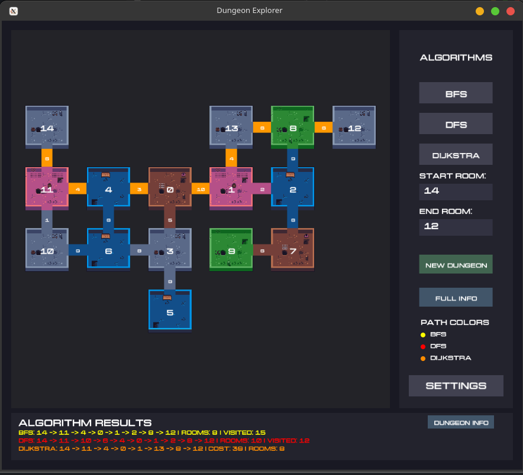
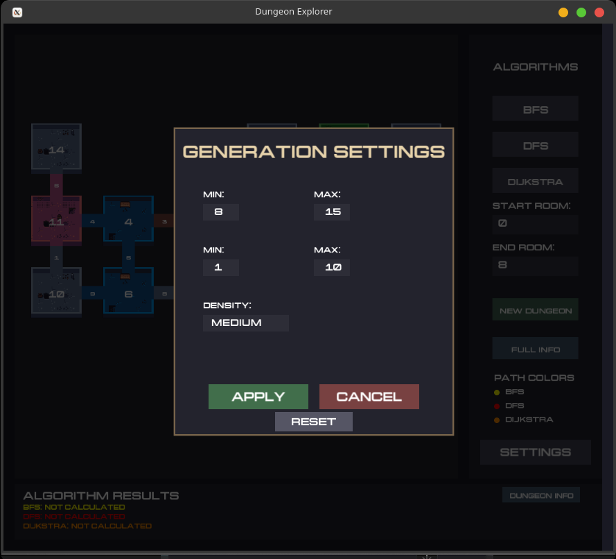

# Dungeon Explorer

<p align="center">
  
</p>

> **Приложение для процедурной генерации подземелий и поиска маршрутов на основе теории графов.**

Dungeon Explorer — приложение на C++17, объединяющее процедурную генерацию подземелий, построение графов и алгоритмы поиска маршрутов. Оно позволяет создавать случайные планировки подземелий, настраивать параметры генерации, визуализировать соединения между комнатами и сравнивать результаты работы различных алгоритмов поиска.

---

## Содержание

- [Обзор проекта](#обзор-проекта)
- [Цели проекта](#цели-проекта)
- [Возможности](#возможности)
- [Режим Explorer Mode](#режим-explorer-mode)
- [Процедурная генерация подземелий](#процедурная-генерация-подземелий)
- [Модель графа](#модель-графа)
- [Алгоритмы поиска маршрутов](#алгоритмы-поиска-маршрутов)
- [Настройки генерации](#настройки-генерации)
- [Визуальная система](#визуальная-система)
- [Тестирование](#тестирование)
- [Структура проекта](#структура-проекта)
- [Используемые технологии](#используемые-технологии)
- [Системные требования](#системные-требования)
- [Сборка и запуск](#сборка-и-запуск)
- [Использование приложения](#использование-приложения)
- [Планы развития](#планы-развития)
- [Планируемые игровые режимы](#планируемые-игровые-режимы)
- [Текущий статус проекта](#текущий-статус-проекта)

---

## Обзор проекта

Dungeon Explorer — графическое приложение, посвящённое процедурной генерации подземелий и поиску маршрутов на основе графов.

Каждое сгенерированное подземелье состоит из комнат, соединённых проходами. Расположение комнат представляет собой визуальную модель графа:

- Комнаты выступают в роли вершин.
- Проходы между комнатами являются рёбрами.
- Каждое соединение имеет числовой вес.

Приложение позволяет генерировать различные планировки подземелий, настраивать параметры генерации, изучать структуру полученного графа и сравнивать маршруты, найденные несколькими известными алгоритмами.

Проект представляет собой интерактивную демонстрацию теории графов, процедурной генерации и алгоритмов поиска маршрутов.

## Цели проекта

Основные цели проекта:

- Разработать систему процедурной генерации подземелий.
- Представлять сгенерированные подземелья в виде связных графов.
- Реализовать алгоритмы обхода графов и поиска кратчайших путей.
- Визуализировать соединения графа, веса рёбер и найденные маршруты.
- Предусмотреть возможность настройки параметров генерации.
- Создать основу для дальнейшего добавления игровых механик.

## Возможности

### Реализовано

- Процедурная генерация комнат подземелья.
- Настраиваемое минимальное и максимальное количество комнат.
- Размещение комнат на условной двумерной сетке.
- Ортогональные соединения между соседними комнатами.
- Генерация связного графа подземелья.
- Предотвращение повторных соединений при генерации.
- Настраиваемая плотность графа.
- Случайные веса рёбер в заданном диапазоне.
- Алгоритмы поиска BFS, DFS и Dijkstra.
- Визуальное выделение найденных маршрутов.
- Отдельные визуальные стили для результатов разных алгоритмов.
- Пять наборов текстур комнат.
- Визуализация коридоров и их весов.
- Автоматическое масштабирование подземелья под доступную область просмотра.
- Отдельный компонент отрисовки подземелья.
- Окно настроек генерации.
- Кнопки Apply, Cancel и Reset.
- Интерактивный интерфейс для исследования сгенерированных подземелий.
- Автоматизированное тестирование графовой логики с использованием GoogleTest.

---

## Режим Explorer Mode

Explorer Mode — основной реализованный режим приложения. Он предназначен для генерации подземелий и изучения лежащих в их основе графовых структур.

Пользователь может создать подземелье, настроить параметры генерации и запустить алгоритмы поиска маршрутов на полученном графе.

Приложение отображает расположение комнат, проходы между ними, веса соединений и маршрут, найденный выбранным алгоритмом.

Основной сценарий работы:

1. Сгенерировать подземелье.
2. Настроить параметры генерации.
3. Изучить полученный граф.
4. Выбрать алгоритм поиска.
5. Указать начальную и конечную комнаты.
6. Просмотреть найденный маршрут.
7. Сгенерировать новое подземелье для исследования другой планировки.

На текущем этапе Explorer Mode является основным функциональным направлением проекта.

## Процедурная генерация подземелий

Генерация подземелья основана на условной двумерной сетке.

### Размещение комнат

- Первая комната размещается в начальной координате сетки `(0, 0)`.
- Остальные комнаты добавляются по одной.
- Каждая новая комната размещается в свободной ортогональной клетке рядом с уже существующей комнатой.
- Генерация продолжается до достижения выбранного количества комнат.
- Итоговое количество комнат случайным образом выбирается в пределах заданного диапазона.

Такой подход предотвращает размещение нескольких комнат в одной клетке и позволяет сохранять связность расположения комнат в процессе генерации.

### Соединение комнат

После размещения комнат система создаёт графовые соединения между ними.

Соединяться могут только ортогонально соседние комнаты:

- Вверх.
- Вниз.
- Влево.
- Вправо.

Диагональное расположение комнат не создаёт диагональных соединений.

Генерация соединений выполняется в два этапа:

1. **Обеспечение связности.** Каждая новая комната соединяется с одной из ранее созданных ортогонально соседних комнат.
2. **Дополнительные соединения.** Система проверяет остальные пары соседних комнат и может создавать дополнительные рёбра с учётом установленной плотности графа.

При генерации дополнительные повторные соединения не создаются.

Связность имеет приоритет над ограничением плотности: обязательные соединения сохраняются, даже если их количество превышает предпочтительный максимум связей для отдельной комнаты.

### Веса соединений

Каждое ребро графа получает случайный вес из установленного минимального и максимального диапазона.

Эти веса используются алгоритмом Дейкстры, а также отображаются непосредственно в подземелье.

---

## Модель графа

Сгенерированное подземелье представляется в виде неориентированного взвешенного графа.

| Элемент подземелья | Элемент графа |
|---|---|
| Комната | Вершина |
| Коридор | Ребро |
| Вес коридора | Вес ребра |
| Планировка подземелья | Визуальное представление графа |

Граф является неориентированным, поскольку соединение между двумя комнатами работает в обоих направлениях.

Граф является взвешенным, поскольку каждое соединение имеет числовую стоимость. Это позволяет демонстрировать как алгоритмы обхода графа, так и поиск кратчайшего пути с учётом весов.

Генерация направлена на создание связного графа, поэтому из начальной комнаты можно добраться до любой другой сгенерированной комнаты.

## Алгоритмы поиска маршрутов

В приложении реализованы три алгоритма работы с графами.

### Поиск в ширину (BFS)

Breadth-First Search — алгоритм, который исследует граф по уровням, сначала посещая ближайшие к начальной вершине вершины, а затем переходя к более удалённым.

- Использует очередь.
- Находит маршрут с минимальным количеством рёбер в невзвешенном графе.
- Не учитывает веса коридоров.

**Визуализация:** найденный маршрут BFS выделяется жёлтым цветом.

<p align="center">
  
</p>

### Поиск в глубину (DFS)

Depth-First Search — алгоритм, который старается пройти как можно дальше по одной ветви графа, прежде чем вернуться назад и исследовать другие направления.

- Использует рекурсивный обход.
- Исследует граф в глубину.
- Находит допустимый маршрут, если он существует, но не гарантирует минимальное количество рёбер или минимальный суммарный вес.

**Визуализация:** найденный маршрут DFS выделяется красным цветом.

<p align="center">
  
</p>

### Алгоритм Дейкстры (Dijkstra)

Алгоритм Дейкстры находит путь с минимальным суммарным весом от начальной вершины до конечной при условии, что веса рёбер неотрицательны.

- Учитывает веса коридоров.
- Хранит наилучшее известное расстояние до каждой вершины.
- Обновляет маршруты, если находит путь с меньшей стоимостью.

**Визуализация:** найденный маршрут Dijkstra выделяется оранжевым цветом.

<p align="center">
  
</p>

### Сравнение алгоритмов

| Алгоритм | Учитывает веса рёбер | Принцип работы | Результат |
|---|---|---|---|
| BFS | Нет | Обход по уровням | Минимальное количество рёбер |
| DFS | Нет | Обход в глубину | Допустимый маршрут, не обязательно оптимальный |
| Dijkstra | Да | Выбор вершины с минимальной накопленной стоимостью | Минимальный суммарный вес при неотрицательных весах |

Результаты работы алгоритмов могут отличаться, поскольку каждый из них использует собственный принцип поиска. Маршрут с наименьшим количеством соединений не обязательно имеет наименьший суммарный вес.

---

## Настройки генерации

Параметры генерации подземелья можно изменять в отдельном окне Settings.

### Количество комнат

Определяет минимальное и максимальное количество комнат, которые могут быть сгенерированы.

- **Min** — минимальное количество комнат.
- **Max** — максимальное количество комнат.

Итоговое количество комнат выбирается случайным образом в пределах заданного диапазона.

### Вес соединений

Определяет диапазон случайных весов, присваиваемых соединениям между комнатами.

- **Min** — минимальный вес соединения.
- **Max** — максимальный вес соединения.

Минимальное значение не должно превышать максимальное.

### Плотность графа

Определяет предпочтительную плотность дополнительных соединений между соседними комнатами.

| Настройка | Значение | Описание |
|---|---:|---|
| Low | 1 | Низкая плотность соединений |
| Medium | 2 | Средняя плотность соединений |
| High | 3 | Высокая плотность соединений |

Значение плотности используется для определения предпочтительного максимального количества соединений комнаты при добавлении дополнительных рёбер.

Обязательные соединения, необходимые для сохранения связности графа, имеют приоритет.

### Применение настроек

Окно настроек предоставляет три действия:

- **Apply** — проверяет введённые значения и применяет настройки.
- **Cancel** — закрывает окно без применения текущих изменений.
- **Reset** — восстанавливает значения по умолчанию. Для применения восстановленных значений необходимо дополнительно нажать Apply.

<p align="center">
  
</p>

---

## Визуальная система

Визуальная система отображает сгенерированный граф в виде подземелья.

### Комнаты

В проекте предусмотрено пять наборов текстур комнат:

- `room_1`
- `room_2`
- `room_3`
- `room_4`
- `room_5`

Каждый набор содержит основное изображение комнаты и прозрачные накладки для проходов:

- `room.png` — основное изображение комнаты.
- `top.png` — проход сверху.
- `down.png` — проход снизу.
- `left.png` — проход слева.
- `right.png` — проход справа.

### Коридоры

Соединения между комнатами отображаются с помощью текстур из папки `roads`.

Для обычных соединений предусмотрены различные цветовые варианты.

### Визуализация маршрутов

Для отображения результатов алгоритмов используются отдельные текстуры:

| Алгоритм | Цвет маршрута |
|---|---|
| BFS | Жёлтый |
| DFS | Красный |
| Dijkstra | Оранжевый |

Одновременно отображается маршрут выбранного алгоритма. Запуск другого алгоритма заменяет ранее выделенный маршрут.

### Отображение подземелья

Размер подземелья автоматически подстраивается под доступную область просмотра. Камера позволяет масштабировать изображение и перемещаться по нему.

---

## Тестирование

Для проверки корректности графовой логики проекта используется библиотека **GoogleTest 1.14.0**.

Тесты проверяют основные компоненты класса `Graph`, включая создание комнат, соединения, настройки, генерацию подземелий и алгоритмы поиска маршрутов.

### Покрытие тестами

В проекте предусмотрено 90 автоматизированных теста:

- 90 дополнительных тестов, разделённых на 9 функциональных блоков.

| Блок | Проверяемая функциональность | Количество тестов |
|---|---|---:|
| 1 | Создание и хранение комнат | 10 |
| 2 | Соединения между комнатами | 10 |
| 3 | Настройки графа | 10 |
| 4 | Генерация комнат | 10 |
| 5 | Генерация соединений | 10 |
| 6 | Алгоритм BFS | 10 |
| 7 | Алгоритм DFS | 10 |
| 8 | Алгоритм Dijkstra | 10 |
| 9 | Очистка графа, счётчики и текстовый вывод | 10 |
| **Всего** | | **90** |

### Что проверяют тесты

**Создание комнат:**
- Добавление одной и нескольких комнат.
- Проверка количества комнат.
- Проверка идентификаторов.
- Проверка порядка хранения.

**Соединения:**
- Создание соединений.
- Симметричность рёбер.
- Корректность сохранения весов.
- Обработка повторных соединений и петель.

**Настройки:**
- Значения настроек по умолчанию.
- Изменение количества комнат.
- Изменение диапазона весов.
- Настройка плотности графа.

**Генерация:**
- Количество сгенерированных комнат.
- Уникальность координат.
- Корректность наборов текстур.
- Положительность координат.
- Создание соединений между соседними комнатами.
- Связность сгенерированного подземелья.

**Алгоритмы поиска:**
- Поиск существующего маршрута.
- Поиск недостижимой комнаты.
- Обработка некорректных идентификаторов.
- Поиск маршрута от комнаты к самой себе.
- Корректность восстановления маршрута.
- Выбор кратчайшего пути для BFS.
- Выбор пути с минимальным суммарным весом для Dijkstra.

**Состояние графа:**
- Очистка графа.
- Проверка счётчика посещённых комнат.
- Повторное добавление комнат после очистки.
- Корректность текстового представления графа.

### Сборка и запуск тестов

После конфигурации проекта выполните:

```bash
cmake --build build
```

Запуск всех тестов через CTest:

```bash
ctest --test-dir build --output-on-failure
```

Запуск тестового исполняемого файла напрямую:

```bash
./build/tests/GraphTests
```

Просмотр списка тестов:

```bash
./build/tests/GraphTests --gtest_list_tests
```

### Используемые инструменты тестирования

- **GoogleTest 1.14.0** — написание и выполнение модульных тестов.
- **CTest** — обнаружение и запуск тестов через CMake.
- **CMake** — конфигурация тестовой сборки.

Тестирование позволяет проверять корректность графовой логики отдельно от графического интерфейса приложения.

---

## Структура проекта

Проект разделён на несколько компонентов: графическую логику приложения, работу с графами, отрисовку подземелья, пользовательский интерфейс и автоматизированные тесты.

```text
project-graph/
├── assets/
│   ├── fonts/
│   │   └── HS_LunaObscura.ttf
│   └── textures/
│       ├── roads/
│       │   ├── blue_road.png
│       │   ├── brown_road.png
│       │   ├── gray_road.png
│       │   ├── green_road.png
│       │   ├── orange_path.png
│       │   ├── purple_road.png
│       │   ├── red_path.png
│       │   └── yellow_path.png
│       ├── room_1/
│       ├── room_2/
│       ├── room_3/
│       ├── room_4/
│       └── room_5/
│
├── screenshots/
│   ├── bfsTry.png
│   ├── dfsTry.png
│   ├── dijTry.png
│   ├── dungeonBase.png
│   └── settingsDungeon.png
│
├── src/
│   ├── main.cpp
│   ├── ui/
│   │   ├── Menu.cpp
│   │   └── Menu.hpp
│   └── game/
│       ├── Game.cpp
│       ├── Game.hpp
│       ├── Graph.cpp
│       ├── Graph.hpp
│       ├── rendering/
│       │   ├── DungeonRenderer.cpp
│       │   └── DungeonRenderer.hpp
│       └── ui/
│           ├── SettingsWindow.cpp
│           └── SettingsWindow.hpp
│
├── tests/
│   ├── CMakeLists.txt
│   └── PathfindingTests.cpp
│
├── CMakeLists.txt
└── README.md
```

### Основные компоненты

| Файл | Назначение |
|---|---|
| `src/main.cpp` | Точка входа в приложение |
| `src/ui/Menu.hpp` | Объявление класса главного меню |
| `src/ui/Menu.cpp` | Реализация главного меню |
| `src/game/Game.hpp` | Объявление основного игрового класса |
| `src/game/Game.cpp` | Игровой интерфейс, обработка событий и управление состоянием приложения |
| `src/game/Graph.hpp` | Объявление структур графа и класса Graph |
| `src/game/Graph.cpp` | Генерация подземелья, создание соединений и реализация алгоритмов поиска |
| `src/game/rendering/DungeonRenderer.hpp` | Объявление компонента отрисовки подземелья |
| `src/game/rendering/DungeonRenderer.cpp` | Визуализация комнат, коридоров и маршрутов |
| `src/game/ui/SettingsWindow.hpp` | Объявление класса окна настроек |
| `src/game/ui/SettingsWindow.cpp` | Интерфейс настроек генерации и обработка взаимодействия с ним |
| `tests/PathfindingTests.cpp` | Автоматизированные тесты графовой логики |
| `tests/CMakeLists.txt` | Конфигурация сборки тестов и подключения GoogleTest |
| `CMakeLists.txt` | Основная конфигурация проекта и системы сборки |

### Разделение ответственности

Архитектура проекта разделяет основные задачи между отдельными компонентами:

- **Graph** отвечает за структуру графа, генерацию комнат и соединений, а также алгоритмы поиска.
- **DungeonRenderer** отвечает за визуальное представление графа в виде подземелья.
- **SettingsWindow** отвечает за интерфейс настройки параметров генерации.
- **Game** объединяет основные компоненты, управляет игровым процессом, обработкой событий и отрисовкой интерфейса.
- **Menu** отвечает за главное меню приложения.
- **GoogleTest** используется для автоматической проверки корректности графовой логики.

Такое разделение упрощает поддержку проекта и позволяет развивать отдельные компоненты независимо друг от друга.

---

## Используемые технологии

- **C++17** — основной язык программирования.
- **SFML 3.0.2** — графика, управление окном и обработка ввода.
- **CMake** — конфигурация и сборка проекта.
- **GoogleTest 1.14.0** — модульное тестирование.
- **CTest** — запуск тестов через систему сборки.
- **Git** — система контроля версий.

## Системные требования

Для сборки проекта необходимы:

- Компилятор C++ с поддержкой C++17.
- CMake.
- Библиотеки разработки SFML 3.0.2.
- Git — для клонирования репозитория.
- Доступ к интернету при первой конфигурации тестовой сборки для загрузки GoogleTest через FetchContent.

Инструкции по установке SFML зависят от операционной системы и используемого менеджера пакетов.

## Сборка и запуск

Следующие команды предназначены для Linux при условии, что все необходимые зависимости установлены.

### 1. Клонирование репозитория

```bash
git clone https://github.com/ArkadiiKabin/project-graph.git
cd project-graph
```

### 2. Конфигурация проекта

```bash
cmake -S . -B build
```

### 3. Сборка

```bash
cmake --build build
```

### 4. Запуск приложения

```bash
./build/DungeonExplorer
```

Если CMake не может найти SFML, убедитесь, что библиотеки разработки SFML 3.0.2 установлены и доступны системе сборки.

Запуск приложения следует выполнять из корневой папки проекта, поскольку ресурсы загружаются относительно текущей рабочей директории.

### 5. Запуск тестов

```bash
ctest --test-dir build --output-on-failure
```

---

## Использование приложения

Типичный сценарий работы в Explorer Mode:

1. Запустить приложение.
2. Открыть настройки генерации при необходимости.
3. Установить минимальное и максимальное количество комнат.
4. Указать диапазон весов соединений.
5. Выбрать плотность графа.
6. Нажать Apply.
7. Сгенерировать подземелье.
8. Указать начальную и конечную комнаты.
9. Выбрать BFS, DFS или Dijkstra.
10. Изучить найденный маршрут и результаты алгоритма.
11. Сгенерировать новое подземелье для исследования другой планировки.

---

## Планы развития

Основная задача следующего этапа разработки — расширение проекта за счёт отдельного игрового режима.

| Возможность | Статус |
|---|---|
| Explorer Mode | Завершено |
| Процедурная генерация комнат | Завершено |
| Генерация связного графа | Завершено |
| BFS | Завершено |
| DFS | Завершено |
| Dijkstra | Завершено |
| Настройки генерации | Завершено |
| Визуализация маршрутов и коридоров | Завершено |
| Автоматизированные тесты графовой логики | Завершено |
| Adventure Mode | Запланировано |
| Дополнительные типы комнат и игровые события | Запланировано |
| Ключи, двери и запертые комнаты | Запланировано |
| Несколько этажей подземелья | Запланировано |
| Битвы с боссами и система прогрессии | Запланировано |
| Dungeon Editor | Запланировано |

Перечисленные планы описывают предполагаемое направление развития и не относятся к уже реализованной функциональности.

## Планируемые игровые режимы

### Adventure Mode

Adventure Mode планируется как отдельный игровой режим, вдохновлённый играми жанра roguelike и dungeon crawler.

В отличие от Explorer Mode, здесь основной акцент будет сделан на непосредственном управлении персонажем, исследовании подземелий и боевой системе.

Предполагаемые возможности:

- Персонаж игрока и исследование подземелья.
- Управление персонажем и перемещение по игровому миру.
- Оружие, стрельба и боевая система.
- Различные типы комнат: обычные комнаты, комнаты с монстрами, сокровищницы и комнаты для восстановления здоровья.
- Запертые комнаты и ключи.
- Несколько этажей подземелья.
- Случайные события во время исследования.
- Постепенное повышение сложности.
- Сражения с боссами на ключевых этапах прохождения.

Adventure Mode будет развиваться как самостоятельная игровая система, независимо от инструментов редактирования карт.

### Dungeon Editor

Dungeon Editor рассматривается как отдельный инструмент для ручного создания и редактирования подземелий.

Основная идея заключается в том, чтобы предоставить пользователю возможность самостоятельно создавать планировки, размещать комнаты и настраивать соединения между ними.

Предполагаемые возможности:

- Ручное размещение комнат.
- Удаление и перемещение комнат.
- Создание и настройка соединений.
- Выбор текстур комнат.
- Настройка весов соединений.
- Сохранение и загрузка созданных подземелий.

Конкретный набор инструментов и принцип работы редактора будут определены на следующих этапах разработки.

---

## Текущий статус проекта

На данный момент Dungeon Explorer представляет собой работоспособную систему процедурной генерации подземелий и визуализации алгоритмов поиска маршрутов на графах.

Реализованный Explorer Mode демонстрирует:

- Представление планировки подземелья в виде графа.
- Процедурное создание графовых структур.
- Создание соединений между соседними комнатами.
- Влияние весов рёбер на поиск кратчайшего пути.
- Различия между BFS, DFS и Dijkstra.
- Визуализацию работы графовых алгоритмов в интерактивном приложении.

Корректность основных операций графа и алгоритмов поиска дополнительно проверяется автоматизированными тестами на GoogleTest.

**Следующим крупным этапом развития станет Adventure Mode** — самостоятельный игровой режим с управлением персонажем, боевой системой, противниками, оружием и процедурно создаваемыми игровыми уровнями.

Dungeon Editor будет развиваться как отдельный инструмент для создания и редактирования подземелий.